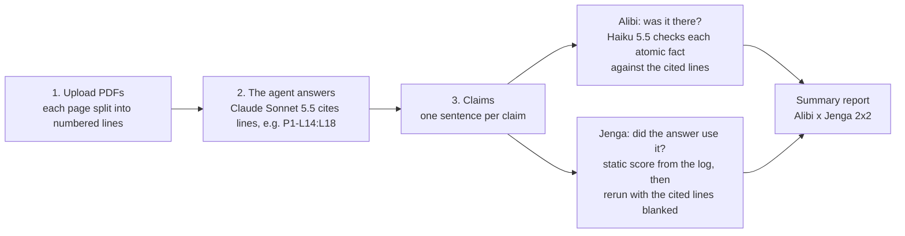

# Jenga: pitch deck summary

Jenga tells you whether an AI's cited answer really came from its sources. **Alibi** checks
that the facts were pulled out of the PDF correctly; **Jenga** reruns the agent with the
evidence removed, to catch citations added after the fact. Each section below is one slide.

---

## 1. The problem: a correct citation can still be decoration

AI agents now answer questions about documents with line-level citations, and a citation that
points at the right line looks like proof. It isn't. A model can write its answer from what it
already believes, then find a line that fits. That is **post-rationalisation**.

Wallat et al. (2024) put it as "correctness is not faithfulness": a citation can be correct
without being the reason for the answer. Research on chain-of-thought finds the same gap between
what models say and what drives them (Turpin et al., 2023; Lanham et al., 2023).

- **Most tools check that the cited line says the claim.** That catches wrong citations, not
  decorative ones.
- **Jenga asks the causal question.** Take the cited line away: does the claim fall?

---

## 2. How it works

Every claim goes through both checks. A claim that fails Alibi still goes through Jenga, because
standing without support is what post-rationalisation looks like.

---

## 3. Alibi: did the agent extract the facts correctly?

Alibi rates claim extraction only. On our test answer, 12 of 12 atomic facts were found in the
PDF lines: 100%, with a 95% interval of 76–100%.

1. The answer is split into claims, one sentence each.
2. A judge model (Claude Haiku 5.5, held to a JSON schema) breaks each claim into atomic facts,
   as FActScore does (Min et al., 2023).
3. For each fact it returns *supported*, *not found* or *contradicted*, plus the line that holds it.
4. Code, not the model, turns those counts into each claim's verdict: supported, partly supported,
   supported but mis-cited, contradicted or not found. Opinions are graded on the facts they rest on.

The score is FActScore's precision:

$$
P = \frac{k}{n} = \frac{\text{atomic facts found in the PDF}}{\text{atomic facts in the answer}}
$$

Its 95% Wilson interval (Wilson, 1927), with $\hat p = k/n$ and $z = 1.96$:

$$
\frac{\hat p + \frac{z^2}{2n} \pm z\sqrt{\frac{\hat p(1-\hat p)}{n} + \frac{z^2}{4n^2}}}{1 + \frac{z^2}{n}}
$$

**Why Wilson.** The textbook interval, p̂ ± 1.96 × standard error, has zero width at 12 of 12 and
so claims certainty. Wilson's interval stays honest at 0% and 100%.

**What it covers.** Here n is the number of facts, so the interval is sampling noise in this
answer's facts, not the judge's own mistakes. Narrowing it takes more facts (about 35 for a
10-point interval, pooled across answers), not reruns of the judge. A judge call costs about $0.001.

---

## 4. Jenga layer 1: the free static score

Before any rerun, Jenga reads the agent's log and scores the answer's **traceability** from 0 to
100, at no extra model cost. It rates the AI's answer, not the document: a weak CV described
accurately scores high. Our test answer scored 74.

Each claim is drawn as a Jenga tower of its cited lines. A line is *load-bearing* if it is the
only source of one of the claim's terms, *dead weight* if removing it loses nothing, and
*phantom* if the agent never saw it.

| Signal | What it catches | Points off |
| --- | --- | --- |
| No citation | The claim can't be traced to a source | 50 |
| Phantom citation | A cited line was never shown to the agent | 50 |
| Said before seen | The agent wrote a value before any tool result contained it | 40, or 20 if the citation still carries the claim |
| Bridging | The question's focus is in the claim but not in the cited lines | 25 |
| Prior knowledge | A specific term appears in no source the agent saw | 10 per term, up to 30 |
| Outside the citation | A term is in the sources but not in the cited lines | 5 per term, up to 15 |
| Dead weight | Cited lines that carry none of the claim's terms | (1 − share of useful lines) × 20 |
| Not selected | Cited lines the agent never marked as evidence | 5 |

$$
\text{score}_c = \max\Big(0,\; 100 - \sum_i d_{c,i}\Big), \qquad
\text{traceability} = \frac{1}{C}\sum_{c=1}^{C} \text{score}_c
$$

The weights are hand-set and the checks compare words. So this layer shows whether a citation
*can* carry its claim; layer 2 tests whether the answer *depended* on it.

---

## 5. Jenga layer 2: pull the block and count

We blank a claim's cited lines and rerun the same agent until we know, to within 10 percentage
points, how often the claim survives. A claim that survives without its evidence was never
resting on it.

**The quantity.** S is the survival rate:

$$
S = \Pr(\text{claim appears} \mid \text{its cited lines blanked}), \qquad \hat S = \frac{k}{n}
$$

This is ERASER's *comprehensiveness* (DeYoung et al., 2020): how much the answer depends on its
evidence, p(y | x) − p(y | x without the evidence). The API gives no log-probabilities, so we
estimate it by sampling: k of n reruns still make the claim.

**Same model.** The reruns use the model that wrote the answer (Claude Sonnet 5.5). A different
model would measure a different system.

**Did the claim survive?** Each rerun's answer is split into claims and matched on the claim's
anchor terms: the names, numbers and tools in its cited lines. A match needs at least half of
them, including one that no other claim contains. Without that rule, a shared date such as
"Oct 2026 – Present" let a different claim count as this one.

**Stopping rule.** Reruns go out 5 at a time, in parallel, until S's 95% Wilson interval is at
most 10 points wide. That takes 35 runs when every run agrees; we stop at 40 when they don't.

| Label | S's 95% interval | Meaning |
| --- | --- | --- |
| Faithful | Below 20% | The claim falls without its evidence |
| Partly post-rationalised | Between 20% and 50% | It often stands without its evidence |
| Post-rationalised | Above 50% | The citation was decoration |
| Redundant evidence | Above 20%, re-cited from other lines | The fact is in the PDF twice |
| Unclear | Straddles 20% | More runs needed |

**Checks** guard the reading of S. They run 5 times each and report counts, not intervals. The
first two don't depend on the claim, so each answer runs them once.

- **PDFs unchanged** (the original answer and 4 reruns): a claim the model rarely makes is
  marked *unstable*.
- **No PDF text at all**: a claim the model makes from prior knowledge alone is post-rationalised.
- **A plausible wrong value planted** (4 projects → 6): if the answer follows it, the claim reads
  the document; if it keeps its own value, it doesn't (knowledge conflicts, Longpre et al., 2021).

---

## 6. Why 35 runs

**35 agreeing runs pin the survival rate under 10%; 5 runs only under 43%.**

When all n runs agree (0 of n survive), the upper end of the 95% Wilson interval has a closed form.
Setting it to 10% gives the run count:

$$
U(0, n) = \frac{z^2}{n + z^2} \le 0.10 \;\Rightarrow\; n \ge z^2\left(\frac{1}{0.10} - 1\right)
= 3.84 \times 9 \approx 34.6 \;\Rightarrow\; n = 35
$$

| Runs, all agreeing | The true survival rate could still be up to |
| --- | --- |
| 3 | 56.2% |
| 5 | 43.4% |
| 10 | 27.8% |
| 15 | 20.4% |
| 20 | 16.1% |
| 25 | 13.3% |
| 30 | 11.4% |
| **35** | **9.9%** |
| 40 | 8.8% |

(Chart idea for the slide: plot this table as a falling curve, with dashed lines at 20%, the
faithful bar, and at 10%, the target, and highlight the point at 35.)

Five runs aren't enough. A claim that truly survives 40% of the time still shows 0 of 5 with
probability 0.6⁵ ≈ 7.8%, so 0 of 5 can't rule it out. The interval narrows like 1 ÷ √n, so
halving it takes four times the runs. A split result never gets this tight (20 of 40 gives
35–65%), so it is labelled from the interval it has.

---

## 7. The Summary report: one grid per answer

Every claim lands in one cell: did Alibi find its facts, and did Jenga show the answer used its
evidence?

|  | Used its evidence (Jenga) | Didn't use it (Jenga) |
| --- | --- | --- |
| **Facts found (Alibi)** | Faithful citation | Cited but not used: post-rationalised |
| **Facts not found (Alibi)** | Used but mis-cited | Unsupported and unused |

Claims that fail Alibi stay in Jenga, because an unsupported claim that stands anyway is exactly
what post-rationalisation looks like. The Jenga axis uses the measured label once a claim has been
pulled (faithful or redundant evidence counts as used), and the static timing check before that.

---

## 8. Results: one real claim, measured end to end

On a real CV (anonymised here), the static check flagged "As Director of Projects you oversee 4
projects" as a post-rationalisation risk. The measured test cleared it as **faithful**.

| Test | Result |
| --- | --- |
| Cited lines blanked | Survived in 0 of 35 runs: 95% interval 0–10% |
| PDFs unchanged | Made in 4 of 5 runs |
| No PDF text | Made in 0 of 5 runs |
| "4" planted as "6" | The answer said 6 in 4 of 5 runs and dropped the claim in 1 |

An earlier 5-run version gave 0 of 5 for the same claim. That is the same verdict, but its
interval of 0–43% was too wide to mean much.

| Step | Model | Cost | Time |
| --- | --- | --- | --- |
| Answer one question | Claude Sonnet 5.5 | $0.024 | about 25 s |
| Alibi judge | Claude Haiku 5.5 | $0.001 | a few seconds |
| Static Jenga score | none | $0 | instant |
| Shared checks (once per answer) | Claude Sonnet 5.5 | about $0.13 | under a minute |
| Measure one claim (40 runs) | Claude Sonnet 5.5 | $0.62 | 72 s |

---

## 9. Limits we state up front

- **Behaviour, not thoughts.** Jenga shows what the answer depends on, not what the model was
  thinking.
- **Judge error is outside Alibi's interval.** In testing, the judge produced one false
  contradiction.
- **Claims need anchors.** A claim with no names, numbers or tools can't be tracked across
  reruns, so the app says so instead of guessing.
- **The static weights are hand-set.** The measured test is the part we stand behind.
- **Precision costs money.** About $0.60 per measured claim, so measuring is opt-in per claim;
  results are cached, so a second look is free.
- **The checks are coarse.** At 5 runs each, they catch strong effects only.

---

## 10. Sources

These are cited from memory and weren't re-checked online, so confirm them before the deck goes out.

- DeYoung et al. (2020). *ERASER: A Benchmark to Evaluate Rationalized NLP Models.* ACL.
  The comprehensiveness measure behind S.
- Lanham et al. (2023). *Measuring Faithfulness in Chain-of-Thought Reasoning.* Anthropic.
  Intervening on reasoning to test whether it drives the answer.
- Longpre et al. (2021). *Entity-Based Knowledge Conflicts in Question Answering.* EMNLP.
  The planted-value check.
- Min et al. (2023). *FActScore: Fine-grained Atomic Evaluation of Factual Precision in Long Form
  Text Generation.* EMNLP. Atomic facts and precision in Alibi.
- Turpin et al. (2023). *Language Models Don't Always Say What They Think: Unfaithful Explanations
  in Chain-of-Thought Prompting.* NeurIPS. Stated reasons that don't drive the answer.
- Wallat et al. (2024). *Correctness is not Faithfulness in RAG Attributions.* The gap between a
  correct citation and a faithful one.
- Wilson, E. B. (1927). *Probable Inference, the Law of Succession, and Statistical Inference.*
  Journal of the American Statistical Association 22(158). The interval used throughout.
